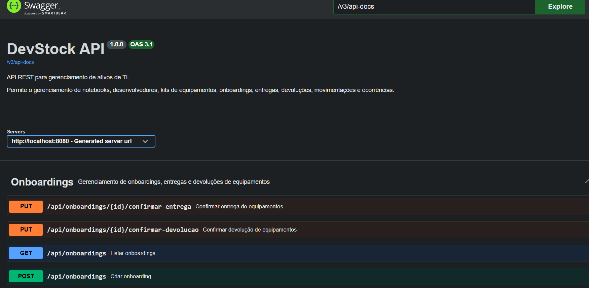

# DevStock — API de Gestão de Ativos de TI

API REST desenvolvida com Java e Spring Boot para gerenciar ativos de TI e apoiar o processo de onboarding de desenvolvedores.

O projeto tem como objetivo aplicar conceitos de desenvolvimento backend em um cenário próximo ao ambiente corporativo, incluindo persistência de dados, organização em camadas, regras de negócio, relacionamentos entre entidades, tratamento de erros e testes automatizados.

## Objetivo do projeto

Facilitar o controle de notebooks e equipamentos disponibilizados aos desenvolvedores, permitindo gerenciar o estoque de ativos, kits de equipamentos, processos de onboarding, entregas, devoluções, ocorrências e histórico de movimentações.

## Tecnologias utilizadas

- Java
- Spring Boot
- Spring Data JPA
- Hibernate
- PostgreSQL
- Maven
- Jakarta Bean Validation
- Springdoc OpenAPI
- Swagger UI
- JUnit 5
- Mockito
- MockMvc
- Git e GitHub

> Consulte o `pom.xml` para verificar as versões exatas das dependências utilizadas no projeto.

## Funcionalidades implementadas

### Gerenciamento de notebooks

- Listagem de notebooks cadastrados.
- Consulta de notebook por identificador.
- Cadastro de notebooks.
- Atualização de informações.
- Exclusão de notebooks, respeitando as restrições de integridade do banco de dados.
- Verificação de duplicidade do número de série.
- Tratamento de conflitos de dados.

### Gerenciamento de desenvolvedores

- Cadastro de desenvolvedores.
- Listagem de desenvolvedores.
- Consulta por identificador.
- Controle de informações cadastrais.
- Restrição de duplicidade de e-mail e matrícula.

### Gerenciamento de kits

- Cadastro e gerenciamento de kits.
- Associação de itens aos kits.
- Organização dos equipamentos que compõem cada kit.
- Utilização dos itens cadastrados na preparação do onboarding.

### Processo de onboarding

- Criação de onboarding vinculando desenvolvedor e kit.
- Associação dos itens do kit ao processo de onboarding.
- Identificação do notebook pelo número de série.
- Verificação da disponibilidade do notebook antes de associá-lo ao onboarding.
- Impedimento de criação de um novo onboarding enquanto existir outro em andamento para o mesmo desenvolvedor.
- Preservação do histórico dos processos de onboarding.
- Consulta de todos os onboardings cadastrados.
- Consulta de onboarding por identificador.
- Confirmação da entrega dos equipamentos.
- Registro automático da data e do responsável pela entrega.
- Atualização automática do status do notebook para `EM_USO` após a entrega.
- Confirmação da devolução dos equipamentos.
- Registro da situação individual dos itens devolvidos.
- Atualização do status do notebook conforme sua condição física.
- Encerramento do onboarding após a devolução.

### Histórico de movimentações

A aplicação possui uma estrutura para registrar e consultar movimentações relacionadas aos notebooks.

Os tipos de movimentação definidos são:

| Tipo | Descrição | Situação |
|---|---|---|
| `ENTREGA` | Registro da entrega do notebook ao desenvolvedor. | Implementado |
| `DEVOLUCAO` | Registro da devolução física do notebook. | Implementado |
| `OCORRENCIA` | Registro de ocorrências relacionadas ao equipamento. | Implementado |

As movimentações de entrega e devolução são registradas automaticamente durante os respectivos processos de onboarding.

As ocorrências podem ser registradas em qualquer notebook, independentemente de existir um onboarding associado. O registro de uma ocorrência não altera automaticamente o status do equipamento.

**Regra importante:** quando um notebook é marcado como `NAO_APRESENTADO`, o onboarding pode ser encerrado, mas o notebook permanece `EM_USO` e não recebe uma movimentação de devolução.

Cada movimentação armazena:

- Notebook relacionado.
- Onboarding associado, quando aplicável.
- Tipo de movimentação.
- Data e hora do evento.
- Responsável pelo registro.
- Observações.

A API também disponibiliza consulta do histórico de movimentações por notebook, ordenado da mais recente para a mais antiga.

## Validações dos DTOs

A aplicação utiliza Jakarta Bean Validation para validar os dados recebidos nos endpoints de criação de onboarding, confirmação de entrega, confirmação de devolução e registro de ocorrências.

As validações são executadas nos controllers por meio da anotação `@Valid`, impedindo que requisições inválidas avancem para a camada de serviço.

### Regras implementadas

| DTO | Campo | Validação |
|---|---|---|
| `CriarOnboardingRequest` | `desenvolvedorId` | Obrigatório e positivo |
| `CriarOnboardingRequest` | `kitId` | Obrigatório e positivo |
| `ConfirmarEntregaRequest` | `responsavel` | Obrigatório, não pode estar em branco e máximo de 150 caracteres |
| `ConfirmarEntregaRequest` | `observacao` | Opcional, máximo de 500 caracteres |
| `ConfirmarDevolucaoRequest` | `responsavel` | Obrigatório, não pode estar em branco e máximo de 150 caracteres |
| `ConfirmarDevolucaoRequest` | `observacao` | Opcional, máximo de 500 caracteres |
| `ConfirmarDevolucaoRequest` | `itens` | Lista obrigatória e não vazia |
| `DevolucaoItemRequest` | `onboardingItemId` | Obrigatório e positivo |
| `DevolucaoItemRequest` | `situacao` | Obrigatória |
| `DevolucaoItemRequest` | `observacao` | Opcional, máximo de 500 caracteres |
| `RegistrarOcorrenciaRequest` | `responsavel` | Obrigatório, não pode estar em branco e máximo de 150 caracteres |
| `RegistrarOcorrenciaRequest` | `observacao` | Obrigatória, não pode estar em branco e máximo de 500 caracteres |

Os itens da lista de devolução também são validados individualmente por meio da validação em cascata com `@Valid`.

Quando os dados recebidos não atendem às regras definidas, a API retorna `400 Bad Request`, com uma resposta padronizada pelo tratamento global de exceções.

## Arquitetura

A aplicação utiliza uma organização em camadas para separar as responsabilidades:

| Camada | Responsabilidade |
|---|---|
| Controller | Receber requisições HTTP e retornar respostas da API. |
| Service | Centralizar as regras de negócio. |
| Repository | Realizar operações de persistência por meio do Spring Data JPA. |
| Entity | Representar as entidades persistidas no banco de dados. |
| DTO | Organizar e validar os dados de entrada e saída da API. |
| Exception | Organizar exceções específicas e o tratamento de erros. |
| Enum | Padronizar valores utilizados nas regras de negócio. |

Essa separação facilita a manutenção, a evolução das funcionalidades e a realização de testes.

## Banco de dados

O PostgreSQL é utilizado para armazenar as informações da aplicação.

O modelo de dados contempla entidades relacionadas à gestão de ativos de TI:

- Desenvolvedor.
- Notebook.
- Kit.
- KitItem.
- Onboarding.
- OnboardingItem.
- Movimentacao.

### Relacionamentos principais

- Um desenvolvedor pode possuir vários registros de onboarding ao longo do tempo.
- Um kit pode conter diversos itens.
- Um onboarding está associado a um desenvolvedor e a um kit.
- Um onboarding possui seus próprios itens, preservando as informações do processo.
- Um item de onboarding pode estar associado a um notebook.
- Uma movimentação está vinculada a um notebook e pode estar associada a um onboarding.

## Endpoints

A API disponibiliza endpoints REST para gerenciamento de notebooks, desenvolvedores, kits, processos de onboarding e movimentações dos equipamentos.

### API de Notebooks

**Endpoint-base:** `/api/notebooks`

| Método | Endpoint | Descrição | Resposta de sucesso |
|---|---|---|---|
| GET | `/api/notebooks` | Lista todos os notebooks | `200 OK` |
| GET | `/api/notebooks/{id}` | Busca notebook pelo ID | `200 OK` |
| POST | `/api/notebooks` | Cadastra um notebook | `201 Created` |
| PUT | `/api/notebooks/{id}` | Atualiza um notebook | `200 OK` |
| DELETE | `/api/notebooks/{id}` | Exclui um notebook | `204 No Content` |

### API de Desenvolvedores

**Endpoint-base:** `/api/desenvolvedores`

| Método | Endpoint | Descrição | Resposta de sucesso |
|---|---|---|---|
| GET | `/api/desenvolvedores` | Lista todos os desenvolvedores | `200 OK` |
| GET | `/api/desenvolvedores/{id}` | Busca desenvolvedor pelo ID | `200 OK` |
| POST | `/api/desenvolvedores` | Cadastra um desenvolvedor | `200 OK` |

### API de Kits

**Endpoint-base:** `/api/kits`

| Método | Endpoint | Descrição | Resposta de sucesso |
|---|---|---|---|
| GET | `/api/kits` | Lista todos os kits | `200 OK` |
| GET | `/api/kits/{id}` | Busca kit pelo ID | `200 OK` |
| POST | `/api/kits` | Cadastra um kit | `201 Created` |
| PUT | `/api/kits/{id}` | Atualiza um kit | `200 OK` |

### API de Onboarding

**Endpoint-base:** `/api/onboardings`

| Método | Endpoint | Descrição | Resposta de sucesso |
|---|---|---|---|
| GET | `/api/onboardings` | Lista todos os onboardings | `200 OK` |
| GET | `/api/onboardings/{id}` | Busca onboarding por identificador | `200 OK` |
| POST | `/api/onboardings` | Cria um onboarding para um desenvolvedor utilizando um kit | `201 Created` |
| PUT | `/api/onboardings/{id}/confirmar-entrega` | Confirma a entrega dos equipamentos | `200 OK` |
| PUT | `/api/onboardings/{id}/confirmar-devolucao` | Confirma a devolução dos equipamentos | `200 OK` |

O endpoint de criação retorna o recurso criado no corpo da resposta e informa sua localização no cabeçalho `Location`.

### API de Movimentações

**Endpoint-base:** `/api/notebooks/{notebookId}`

| Método | Endpoint | Descrição | Resposta de sucesso |
|---|---|---|---|
| POST | `/api/notebooks/{notebookId}/ocorrencias` | Registra uma ocorrência relacionada ao notebook | `201 Created` |
| GET | `/api/notebooks/{notebookId}/movimentacoes` | Consulta o histórico de movimentações do notebook | `200 OK` |

## Documentação da API — OpenAPI / Swagger

O projeto utiliza Springdoc OpenAPI para gerar automaticamente a documentação dos endpoints REST, seguindo a especificação OpenAPI.

A documentação permite visualizar os recursos disponíveis, consultar os métodos HTTP, verificar os parâmetros e modelos de requisição e resposta, além de executar chamadas diretamente pela interface Swagger UI.

### Acessos

| Recurso | Endereço |
|---|---|
| Swagger UI | `http://localhost:8080/swagger-ui/index.html` |
| Especificação OpenAPI em JSON | `http://localhost:8080/v3/api-docs` |

### Recursos documentados

A documentação contempla os seguintes grupos de operações:

- Notebooks: cadastro, consulta, atualização e exclusão.
- Desenvolvedores: cadastro e consultas.
- Kits: cadastro, consulta e atualização.
- Onboardings: criação, consulta, confirmação de entrega e devolução.
- Movimentações: registro de ocorrências e consulta do histórico de notebooks.

Os endpoints possuem descrições e respostas HTTP documentadas, incluindo os principais cenários de sucesso, validação, recurso não encontrado, conflito e erro interno do servidor.

A interface Swagger UI fica disponível quando a aplicação está em execução e o banco de dados está acessível.

### Visualização do Swagger UI

A imagem abaixo apresenta a interface de documentação da API DevStock, com a identificação da versão e os endpoints de onboarding.



## Exemplos de requisições

### Criar onboarding

`POST /api/onboardings`

```json
{
  "desenvolvedorId": 1,
  "kitId": 1
}
```

Exemplo de resposta:

```json
{
  "id": 1,
  "desenvolvedorId": 1,
  "kitId": 1,
  "status": "EM_ANDAMENTO",
  "dataCriacao": "2026-11-10T16:20:11"
}
```

### Confirmar entrega

`PUT /api/onboardings/2/confirmar-entrega`

```json
{
  "responsavel": "Luciano Rodrigues",
  "observacao": "Entrega do kit realizada e equipamentos conferidos."
}
```

Exemplo de resposta:

```json
{
  "id": 2,
  "status": "EM_ANDAMENTO",
  "dataEntrega": "2026-11-10T17:54:01",
  "responsavelEntrega": "Luciano Rodrigues"
}
```

A confirmação da entrega também registra automaticamente uma movimentação do tipo `ENTREGA`, vinculada ao notebook e ao onboarding correspondente.

Uma nova tentativa de confirmar a mesma entrega é impedida pela regra de negócio, retornando `409 Conflict`.

### Confirmar devolução

`PUT /api/onboardings/3/confirmar-devolucao`

O processo de devolução registra o responsável, a data da operação e a situação individual dos equipamentos.

As regras de atualização do notebook são:

| Situação do item | Status resultante do notebook |
|---|---|
| `BOM_ESTADO` | `DISPONIVEL` |
| `DANIFICADO` | `MANUTENCAO` |
| `NAO_APRESENTADO` | Permanece `EM_USO` |

A devolução física dos equipamentos também gera movimentações do tipo `DEVOLUCAO`. Para itens não apresentados, não é registrada movimentação de devolução.

### Registrar ocorrência

`POST /api/notebooks/13/ocorrencias`

```json
{
  "responsavel": "Luciano Rodrigues",
  "observacao": "Notebook apresentou falha na inicialização do sistema operacional."
}
```

Exemplo de resposta:

```json
{
  "id": 8,
  "notebookId": 13,
  "tipo": "OCORRENCIA",
  "dataHora": "2026-11-14T12:37:13.241615",
  "responsavel": "Luciano Rodrigues",
  "observacao": "Notebook apresentou falha na inicialização do sistema operacional."
}
```

O registro de ocorrência não exige vínculo com um onboarding e não altera automaticamente o status do notebook.

O responsável e a descrição da ocorrência são obrigatórios.

### Consultar histórico de movimentações

`GET /api/notebooks/13/movimentacoes`

Exemplo de resposta:

```json
[
  {
    "id": 8,
    "notebookId": 13,
    "onboardId": null,
    "tipo": "OCORRENCIA",
    "dataHora": "2026-11-14T12:37:13.241615",
    "responsavel": "Luciano Rodrigues",
    "observacao": "Notebook apresentou falha na inicialização do sistema operacional."
  },
  {
    "id": 5,
    "notebookId": 13,
    "onboardId": 4,
    "tipo": "ENTREGA",
    "dataHora": "2026-11-12T15:38:07.151293",
    "responsavel": "Luciano Rodrigues",
    "observacao": "Entrega do kit de teste para validar devolução de notebook não apresentado."
  }
]
```

O histórico apresenta as movimentações em ordem decrescente de data e hora.

Quando o notebook existe, mas ainda não possui movimentações, a API retorna uma lista vazia (`[]`). Para um notebook inexistente, retorna `404 Not Found`.

## Tratamento de erros

A aplicação possui tratamento global de exceções para padronizar erros e respostas da API.

| Código HTTP | Significado |
|---|---|
| `400 Bad Request` | Requisição malformada, validação ou parâmetro inválido |
| `404 Not Found` | Recurso não encontrado |
| `409 Conflict` | Conflito de cadastro ou violação de regra de negócio |
| `500 Internal Server Error` | Erro inesperado no servidor |

O tratamento global contempla exceções de recursos não encontrados, conflitos de cadastro, violações de integridade, erros de conversão de parâmetros, falhas de validação e erros inesperados.

As respostas de erro seguem uma estrutura padronizada com os campos `erro` e `mensagem`.

## Testes automatizados

O projeto possui testes automatizados utilizando JUnit 5, Mockito e MockMvc.

A suíte atual contempla **26 testes automatizados**, distribuídos da seguinte forma:

| Classe de teste | Quantidade | Cobertura |
|---|---:|---|
| `NotebookServiceTest` | 9 | Regras de negócio do serviço de notebooks |
| `NotebookControllerTest` | 6 | Endpoints HTTP do controller de notebooks |
| `GlobalExceptionHandlerTest` | 6 | Tratamento global de exceções |
| `OnboardControllerTest` | 3 | Validações das requisições de onboarding, entrega e devolução |
| `MovimentacaoControllerTest` | 2 | Validações das requisições de registro de ocorrências |
| **Total** | **26** | |

Os testes de serviço utilizam mocks para isolar as regras de negócio.

Os testes dos controllers utilizam MockMvc para simular requisições HTTP sem iniciar um servidor externo. Também verificam se requisições inválidas são rejeitadas antes de chegar à camada de serviço.

Os testes do tratamento de erros verificam as respostas produzidas pelo handler global.

**Resultado da última execução da suíte:**

- 26 testes executados.
- 0 falhas.
- 0 erros.
- 0 testes ignorados.
- `BUILD SUCCESS`.

**Importante:** a suíte atual não depende de uma conexão com PostgreSQL. Os testes não substituem testes de integração com o banco de dados, que poderão ser adicionados em uma etapa futura.

### Executando os testes

Na pasta raiz do projeto, execute:

```powershell
.\mvnw.cmd clean test
```

Para uma execução bem-sucedida, o resultado esperado é:

```text
Tests run: 26, Failures: 0, Errors: 0, Skipped: 0

BUILD SUCCESS
```

## Configuração do ambiente

### Pré-requisitos

- JDK compatível com a versão configurada no projeto.
- PostgreSQL para execução da aplicação.
- Git.

O Maven Wrapper está incluído no repositório para facilitar a execução dos comandos Maven.

### Configuração do banco de dados

Crie o banco de dados `devstock` no PostgreSQL e configure as variáveis de ambiente utilizadas pela aplicação:

- `DB_URL`: endereço de conexão com o banco.
- `DB_USERNAME`: usuário do banco.
- `DB_PASSWORD`: senha do banco.

A aplicação utiliza o Hibernate para validar o mapeamento das entidades em relação à estrutura existente no banco de dados.

**Importante:** a configuração atual utiliza `ddl-auto=validate`. Portanto, é necessário que as tabelas e colunas esperadas já existam e sejam compatíveis com as entidades Java.

Nunca publique senhas ou credenciais reais no repositório.

### Executando a aplicação no Windows

No terminal, acesse a pasta raiz do projeto e execute:

```powershell
.\mvnw.cmd clean compile
```

Se a compilação terminar com sucesso, inicie a aplicação:

```powershell
.\mvnw.cmd spring-boot:run
```

A execução depende de o PostgreSQL estar acessível e de as variáveis de ambiente estarem configuradas corretamente.

## Checklist de evolução do projeto

### Gestão de notebooks

- [x] Implementar CRUD de notebooks.
- [x] Implementar validações de cadastro e tratamento de erros.

### Processo de onboarding

- [x] Implementar criação de onboarding.
- [x] Validar disponibilidade dos equipamentos antes da entrega.
- [x] Implementar confirmação de entrega dos equipamentos.
- [x] Registrar automaticamente a movimentação `ENTREGA`.
- [x] Implementar processo de devolução dos equipamentos.
  - [x] Registrar responsável e data da devolução.
  - [x] Registrar a situação individual dos itens.
  - [x] Retornar notebook em bom estado para `DISPONIVEL`.
  - [x] Alterar notebook danificado para `MANUTENCAO`.
  - [x] Registrar item não apresentado sem alterar seu status `EM_USO`.
  - [x] Encerrar onboarding após a devolução.
  - [x] Finalizar validações e testes dos cenários de devolução.
- [x] Registrar automaticamente a movimentação `DEVOLUCAO` e validar os cenários implementados.

### Próximas funcionalidades

- [x] Implementar registro de ocorrências.
- [x] Criar endpoint de histórico de movimentações por notebook.
- [x] Ampliar a documentação da API com exemplos de requisições.
- [x] Revisar e ampliar o tratamento de erros.
- [x] Implementar testes automatizados (26 testes, sem dependência do PostgreSQL).
- [x] Revisar validações dos DTOs e aplicar `@Valid` nos endpoints correspondentes.
- [x] Configurar documentação OpenAPI/Swagger.
- [ ] Preparar ambiente com Docker.
- [ ] Implementar testes de integração com PostgreSQL.

## Status

**Em desenvolvimento.**

O DevStock é um projeto prático de aprendizado e portfólio, com evolução incremental das funcionalidades e aplicação de conceitos de desenvolvimento backend com Java e Spring Boot.

## Autor

Desenvolvido por Luciano Rodrigues.

- GitHub: [larsilvapx](https://github.com/larsilvapx)
- Repositório: [DevStock](https://github.com/larsilvapx/devstock)

